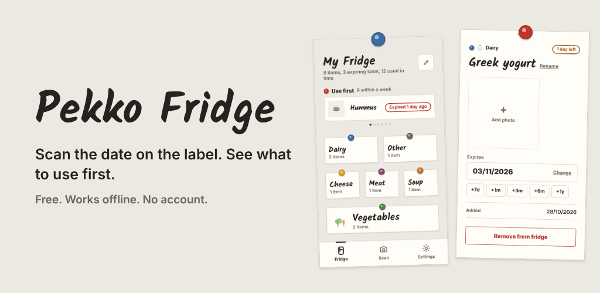
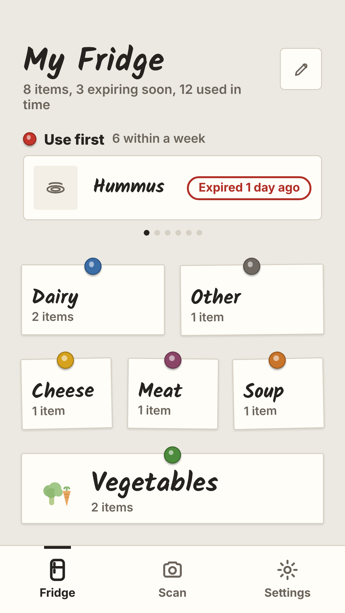
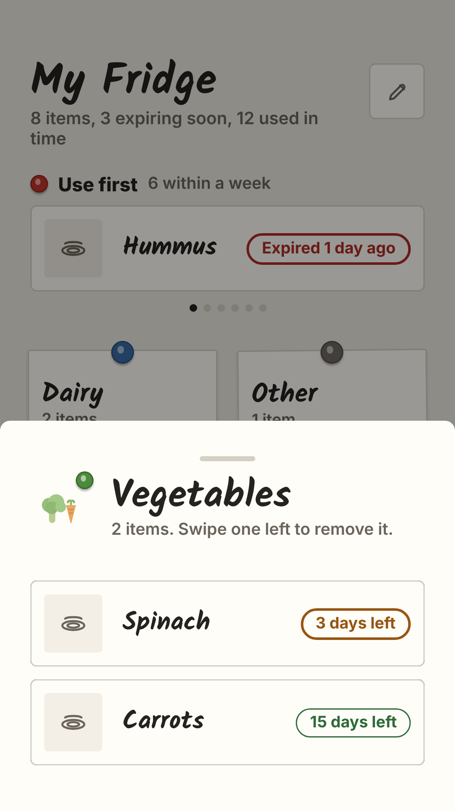
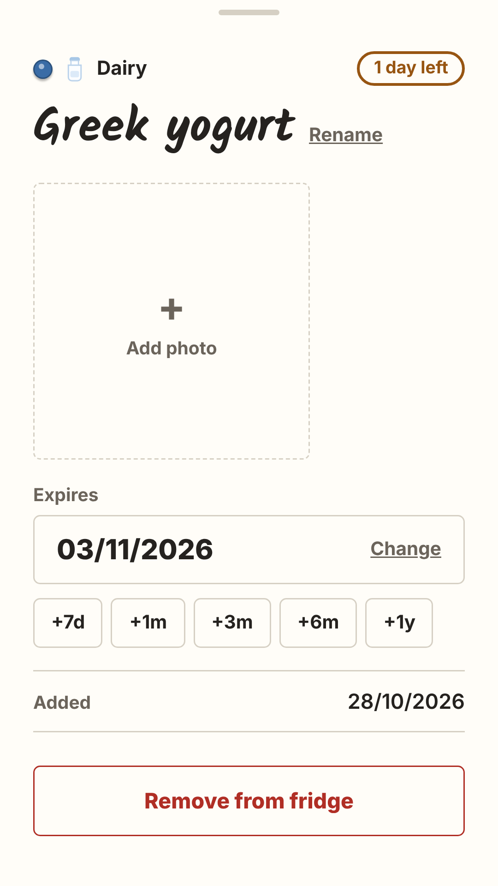
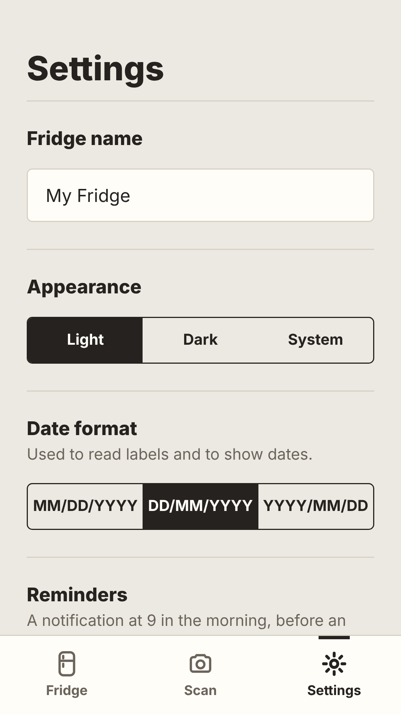

# Pekko Fridge



Pekko Fridge is a private expiry date tracker for the things you buy: food, medicine, cosmetics, and anything else with a date on it. Everything runs on your phone. There is no internet connection, no account, and no data collection, and the app is free.

Point the camera at a product's date label. Pekko reads the date on your device, works out how many days are left, and puts the item on your fridge so you know what to use first.

<p>




</p>

## What it does

Scan dates with the camera. A crop guide shows what will be read, then Pekko reads the printed date on device and calculates the days remaining. Setting a date by hand is quick too. One tap adds a week, a month, or a year, so far off dates never mean endless scrolling.

Keep photos of each item. You can attach pictures of the label or the product so you remember exactly what it is. The photos stay on your phone.

Organise your fridge into folders. You start with Dairy, Cheese, Meat, Soup, Vegetables, and Other, each pinned to the fridge door as a note under its own coloured magnet. Add your own folders, rename them, drag to reorder, or hide the ones you don't use, all from the fridge screen.

See what to use first. Every item shows how many days are left, ringed in a colour that gets louder as the date gets closer. A "Use first" strip under a red magnet lists everything that expires within a week.

Get a reminder. Turn on notifications and Pekko tells you before an item expires. Right from the reminder you can tap "Mark used" or "Snooze 2 days" without opening the app.

Settings. Rename your fridge, switch between light, dark, and system themes, and choose the date format used where you live.

## Privacy

Everything happens locally. The camera is only used to read expiry dates, and images never leave the device. No cloud, no tracking, no sign up.

## How it works

Pekko is a fully offline app. There is no server and no network code, and all your data lives on the device.

The scan flow. The camera captures a cropped photo of the date label. Skia sharpens it with grayscale and strong contrast, then Google ML Kit reads the text on the device. A date engine written in plain JavaScript works out the date. It handles numeric dates in any regional order, written out months, keywords like EXP, BBD and use by (Japanese included), and it tells manufacture dates apart from expiry dates. You confirm the result and save.

State. A single store holds your settings and items and saves to local storage on every change, so nothing is ever lost, even if the app is closed part way through an edit.

Interface. A swipe pager for Fridge, Scan and Settings, and a fridge door you can rearrange (drag, rename, add and hide folders in an edit mode). Names are written in Kalam, a marker hand by the Indian Type Foundry (SIL Open Font License, see `assets/fonts/Kalam-OFL.txt`). The food icons are drawn as SVG.

Reminders. Local notifications fire before an item expires, with "Mark used" and "Snooze 2 days" buttons.

## Tech stack

| Layer | Technology |
|-------|------------|
| Language | JavaScript (React 19, JSX) |
| Framework | React Native 0.85, Expo SDK 56 (New Architecture) |
| On device OCR | `@react-native-ml-kit/text-recognition` (Google ML Kit) |
| Image preprocessing | `@shopify/react-native-skia` (grayscale and contrast on the GPU) |
| Camera | `expo-camera` |
| Date parsing | Custom engine in plain JavaScript (Node unit tests) |
| Local storage | `@react-native-async-storage/async-storage` (no cloud) |
| Notifications | `expo-notifications`, scheduled locally |
| Graphics and UI | `react-native-svg`, `expo-font` (Kalam), `expo-haptics`, `react-native-safe-area-context` |
| Build and release | EAS Build, Android App Bundle, Google Play |

No backend, no analytics, no third party network calls.

## Project structure

```
App.js                  Navigation shell (swipe pager and bottom tab bar)
src/
  store.js              Single source of truth for settings and items, saved locally
  theme.js              Colours, spacing, magnet colour per folder
  screens/
    FridgeScreen.js     The fridge and the folder edit mode
    ScannerScreen.js    Camera and scan flow
    SettingsScreen.js   Theme, reminders, date format
  components/           Fridge pieces, edit grid, sheets, date field, icons
  lib/
    ocr.js              ML Kit wrapper, falls back when unavailable
    enhance.js          Skia image preprocessing for OCR
    dateParser.js       Date engine in plain JavaScript, tested
    expiry.js           Countdown and badge helpers
```

## Status

Version 1.2.3, built with Expo and React Native for Android.

## License

Copyright 2026 Wali Lambert. All rights reserved. The code is public so you can read it (it is part of my portfolio), but it is not open source. Please do not copy, reuse, or publish it, or any version of it, without my permission. See the LICENSE file for details.

## Support

Pekko is made by one person, in my own time, and given away for free with no ads, no tracking, and no paywall. If it saves you a little money or hassle, you can leave a tip. Tips help me keep it updated.

<a href="https://buymeacoffee.com/walilambere" target="_blank"></a>
